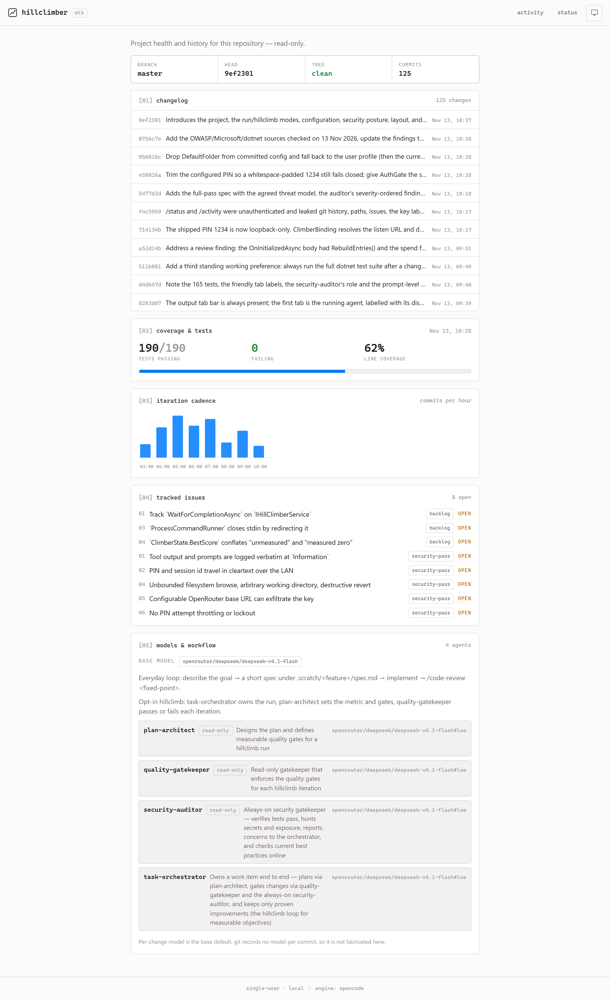

# Hillclimber

**A local dashboard for driving OpenCode runs and hillclimb loops.**

<br clear="left" />

[](#testing)
[](#testing)
[](https://dotnet.microsoft.com/)
[](https://learn.microsoft.com/aspnet/core/blazor/)
[](#license)

Hillclimber is a single-user, local-only web dashboard for running the
[OpenCode](https://opencode.ai) CLI against a project folder. It has two modes:

- **run** — one OpenCode run with a prompt, streamed live.
- **hillclimb** — a gated loop that iterates on a measurable objective, keeping the best
  result and delegating to the project's own agents.

It is built for my own workflow, but it is a real, tested application rather than a
throwaway script. It runs on the LAN so a phone can drive it, behind a PIN.



## What it does

- **Run or hillclimb** from one page, with a method switch and method-aware pre-flight.
- **Uses the target project's agents** — `opencode run --agent <name>` — falling back to the
  global OpenCode config, then OpenCode's default.
- **Live output tabs** — the running agent gets the first tab, each subagent call gets its
  own, and the primary tab keeps a marker pointing at the delegated work.
- **Telemetry** — status, spend, tokens, elapsed time, iteration, best score, and last test
  result, streamed from OpenCode's own events.
- **Prompt handoff** — the instruction leaves the prompt box as soon as a run or climb takes
  it (so the same text can't be fired twice), and an idle box offers the last prompt back
  with one click.
- **Pluggable providers** — an ordered `Climber:Providers` registry. The first provider is
  primary; later providers are offered only after explicit approval, one approved step at a
  time. Any OpenAI-compatible catalogue, an OpenRouter-style management API, or a provider
  that `opencode` manages itself (no API surface) can be configured without code changes.
- **Status page** — branch, HEAD, tree state, commit cadence, coverage, tracked issues, and
  the configured agents/workflow.
- **Activity page** — one card per configured provider: connection state, catalogue
  pricing, key/account spend, rolling 30-day activity, and a token-based session estimate.
- **PIN gate** — every page is locked until the session enters the PIN; the session slides
  with activity and re-locks after the idle timeout.
- **LAN-friendly** — binds `0.0.0.0:5179` when a real PIN is configured, so a phone on the
  same Wi-Fi can use it.

## Quick start

### Prerequisites

- [.NET 11 SDK](https://dotnet.microsoft.com/download)
- [OpenCode](https://opencode.ai) on `PATH` (the dashboard shells out to `opencode run`)
- At least one provider configured for `opencode`. The shipped default is Surplus
  Intelligence (`SURPLUS_API_KEY` or `Climber:SurplusApiKey`), with OpenRouter offered as
  the approval-gated fallback when its key is present.

### Run it

```sh
dotnet run --project ClimberWeb
```

Open <http://localhost:5179>. With no PIN configured, the app uses the default `1234` and
**listens on localhost only**.

To expose it on the LAN, set a real PIN in `ClimberWeb/appsettings.local.json` (gitignored)
or an environment variable:

```json
{
  "Climber": {
    "Pin": "your-real-pin"
  }
}
```

```sh
# or
$env:Climber__Pin = "your-real-pin"
```

Then open `http://<your-machine>:5179` from the phone.

## Configuration

Settings live in `ClimberWeb/appsettings.json`, with local overrides in the gitignored
`ClimberWeb/appsettings.local.json` or environment variables (`Climber__Pin`, etc.).

### Providers

`Climber:Providers` is an ordered array. The first entry is primary; each later entry is a
fallback, offered only after explicit approval. Omit the array to keep the shipped
Surplus/OpenRouter pair from the legacy keys below.

```json
{
  "Climber": {
    "Providers": [
      {
        "Id": "surplus",
        "Name": "Surplus",
        "Kind": "openai",
        "Prefix": "surplus",
        "Model": "surplus/deepseek-v4.1-flash-1017",
        "BaseUrl": "https://api.surplusintelligence.ai/min80/v1",
        "RequiresKey": true,
        "SendKey": false
      },
      {
        "Id": "openrouter",
        "Name": "OpenRouter",
        "Kind": "openrouter",
        "Prefix": "openrouter",
        "Model": "openrouter/deepseek/deepseek-v4.1-flash",
        "BaseUrl": "https://openrouter.ai/api/v1"
      }
    ]
  }
}
```

| Field | Default | Purpose |
|-------|---------|---------|
| `Id` | — (required) | Stable identity and the `opencode` model prefix. |
| `Name` | title-cased `Id` | Label in the dashboard. |
| `Kind` | `none` | `openai` (OpenAI-compatible `GET /models`), `openrouter` (`/key`, `/credits`, `/activity`), or `none` (opencode-managed). |
| `Prefix` | `Id` | Serving-provider prefix for `--model`. |
| `Model` | built-in for `surplus`/`openrouter` | Model id; null lets `opencode` decide. |
| `BaseUrl` | built-in for `surplus`/`openrouter` | API base; trailing slash trimmed. |
| `ApiKey` | - | Inference/catalogue key; also read from an id-derived variable such as `ACME_LABS_API_KEY` (upper-cased, with `-` and `.` replaced by `_`). |
| `ManagementApiKey` | — | Management key for the OpenRouter-style spend surface. |
| `RequiresKey` | `true` (`false` for `none`) | Set false for a local host that needs no key. |
| `SendKey` | `true` | Set false for a catalogue that does not accept the key (Surplus). |
| `Spend` | derived from `Kind` | Optional override: `estimated`, `reported`, `none`. |

### Other settings

| Key | Default | Purpose |
|-----|---------|---------|
| `Climber:Pin` | `1234` (loopback only) | PIN for the dashboard. Set a real value to bind on the LAN. |
| `Climber:SessionMinutes` | `30` | Idle minutes before a session re-locks. |
| `Climber:DefaultFolder` | user profile | Folder shown in the target picker. |
| `Climber:DefaultAgent` | `task-orchestrator` | Agent to run when the target provides one. |

Legacy provider keys remain aliases when `Climber:Providers` is absent:

| Key | Default | Purpose |
|-----|---------|---------|
| `Climber:SurplusApiKey` | — | Primary key. `SURPLUS_API_KEY` is also read. |
| `Climber:SurplusBaseUrl` | `https://api.surplusintelligence.ai/min80/v1` | Surplus API base. |
| `Climber:SurplusModel` | `surplus/deepseek-v4.1-flash-1017` | Model passed to `opencode run --model`. |
| `Climber:FallbackModel` | `openrouter/deepseek/deepseek-v4.1-flash` | OpenRouter model offered after approval. |
| `Climber:OpenRouterApiKey` | — | Fallback inference key; also used for `GET /key`. |
| `Climber:OpenRouterManagementApiKey` | — | Management key for `/credits` and `/activity`. |
| `Climber:OpenRouterBaseUrl` | `https://openrouter.ai/api/v1` | OpenRouter API base. |

`SURPLUS_API_KEY`, `OPENROUTER_API_KEY`, and `OPENROUTER_MANAGEMENT_API_KEY` are also read.
Never commit real keys; `*.local.json` is gitignored. A provider with a catalogue prices
its spend from tokens × catalogue pricing; one with a management surface keeps the exact
reported cost; a provider with neither shows `—` rather than a made-up zero.

## Security posture

This is a personal tool, not a multi-tenant service. The security model is deliberately
small:

- **Every page is PIN-gated.** `/`, `/status`, and `/activity` share one session.
- **The shipped default PIN is loopback-only.** A real PIN is required before the app binds
  beyond `localhost`.
- **Secrets stay local.** Keys live in `appsettings.local.json` or environment variables;
  the file is gitignored and never logged.
- **No shell string interpolation.** Commands are launched with `ArgumentList` and
  `UseShellExecute = false`.
- **Razor encodes output.** There are no `MarkupString`/`Html.Raw` sinks.

Known trade-offs and follow-ups are tracked in
[`.scratch/security-pass/`](.scratch/security-pass/): cleartext LAN traffic, PIN attempt
throttling, tool-output logging, filesystem scope, and the OpenRouter base-URL override.

## Project layout

```
ClimberWeb/            Blazor Server app (pages, services, auth, command runner)
ClimberWeb.Tests/      xUnit tests (311 passing)
scripts/               status/coverage, fixture, and Playwright UI checks
status/                committed coverage/test artifact read by /status
fixtures/              throwaway sample project for climb proofs
.opencode/agents/      task-orchestrator, plan-architect, quality-gatekeeper, security-auditor
.scratch/              specs and tracked issues (local markdown)
docs/                  logo and README assets
```

## Testing

```sh
# Unit + integration tests (free)
dotnet test --nologo

# Regenerate the committed status/coverage.json artifact
powershell -File scripts/status.ps1

# Free browser checks (server running)
cd scripts/ui
node theme-nav.mjs      # theme survives navigation
node security.mjs       # /status and /activity are PIN-gated
node providers.mjs      # provider bar, approval copy, one /activity card per provider

# Token-spending browser check (drives real OpenCode runs, Surplus only)
npm run surfaces
```

The token-spending harness refuses (exit `2`) unless Surplus is the *only* configured
provider and reports `connected`. The legacy keys always synthesise Surplus **and**
OpenRouter, so pin the array to one entry before running it:

```json
{
  "Climber": {
    "Providers": [
      {
        "Id": "surplus",
        "Name": "Surplus",
        "Kind": "openai",
        "Prefix": "surplus",
        "Model": "surplus/deepseek-v4.1-flash-1017",
        "BaseUrl": "https://api.surplusintelligence.ai/min80/v1",
        "SendKey": false
      }
    ]
  }
}
```

`SURPLUS_API_KEY` still supplies the key. Each run's echoed command line must use a
`surplus/` model and no `openrouter/`; the harness stops before the second paid run when
the first does not, and never approves a fallback. Exit codes: `0` all checks passed, `1` a
check failed, `2` refused to continue (configuration, connection, or a paid run that did
not use Surplus).

Current state: **311 tests passing, 0 failed, 0 skipped**, **63.11% line coverage**. The
token-spending `surfaces.mjs` harness is **not run** as part of the default checks.

## License

Personal project — not licensed for reuse. The code is public for reference and learning;
please don't deploy it as a service.
